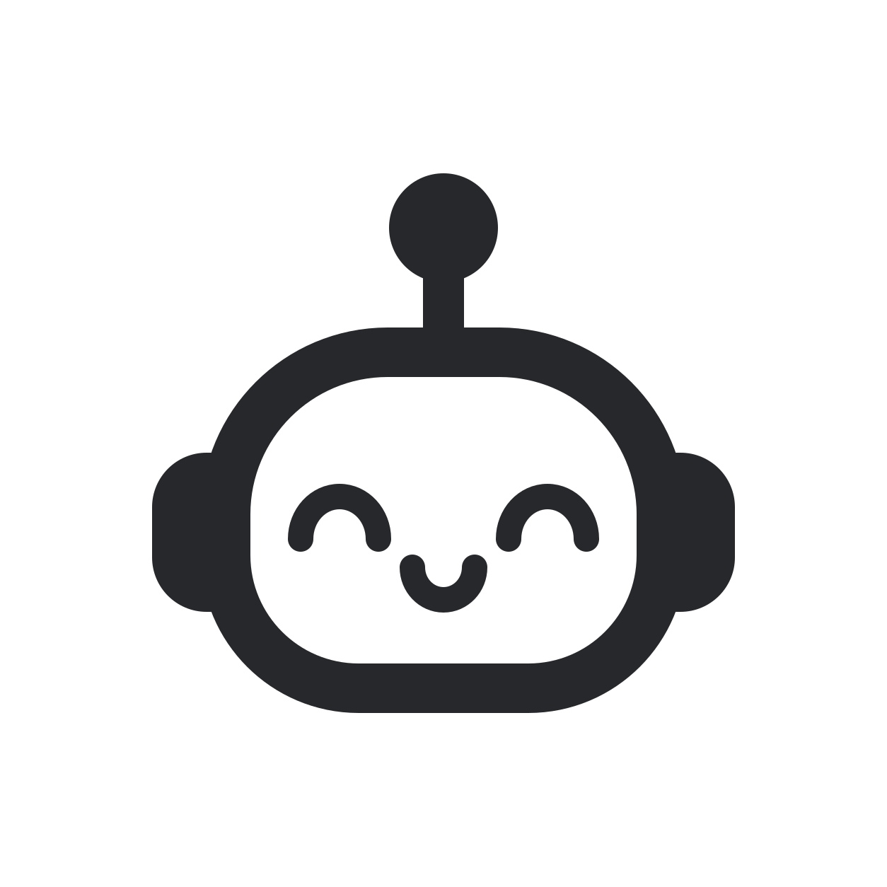

<p align="center">
  <picture>
    <source media="(prefers-color-scheme: dark)" srcset="assets/logo-dark.svg">
    
  </picture>
</p>

<h1 align="center">Sancho</h1>

<p align="center">
  A personal Discord agent: one long-running <a href="https://code.claude.com">Claude Code</a> session<br>
  in a locked-down Docker container, answering @mentions in the channels you allow.
</p>

- Reads the web, PDFs and attachments
- Remembers across restarts, in one folder
- Installs its own tools with `uv` and `bun`
- No access to your files, your Claude config, or your local network

## Run

```bash
docker compose up -d --build
```

Then mention `@Sancho` in an allowed channel. First time? Follow [Onboarding](docs/ONBOARD.md).

## Docs

- [Onboarding](docs/ONBOARD.md): Claude key, Discord bot, channels, inviting friends
- [Architecture](docs/ARCHITECTURE.md): how it works, isolation, known limits

Built on Claude Code [Channels](https://code.claude.com/docs/en/channels), a research preview.
