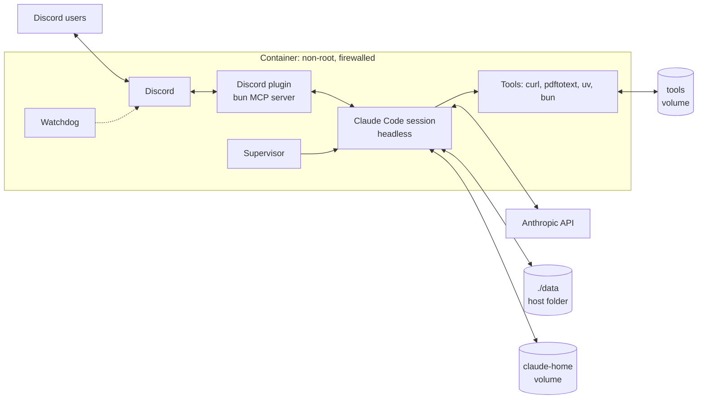

# Architecture

Sancho is one headless Claude Code session (Agent SDK mode), kept alive in a container by a small supervisor, with the official Discord channel plugin feeding it messages.

## Message flow

1. A user @mentions Sancho, or replies to one of his messages, in an allowlisted channel.
2. The plugin checks the sender and channel against `access.json`. Anything not allowed is dropped before Claude sees it.
3. The message is injected into the running session as a channel event tagged with channel, message and user.
4. Claude works (web fetch, shell, files) and answers by calling the plugin's `reply` tool. Plain output never reaches Discord.

The plugin exposes five tools: `reply`, `react`, `edit_message`, `fetch_messages`, `download_attachment`.

## Boot sequence

`restart: always` keeps the container up. Each start runs these from `docker/`:

| Step | Script | Runs as | Does |
|---|---|---|---|
| 1 | `firewall.sh` | root | Rejects outbound traffic to private network ranges |
| 2 | `entrypoint.sh` | root, then `sancho` | Drops privileges, clears empty env vars, starts the rest |
| 3 | `setup.sh` | `sancho` | Pre-answers Claude Code's first-run prompts, seeds the Discord allowlist on first boot, installs the plugin and its dependencies |
| 4 | `watchdog.ts` | `sancho` | Follows the session log; when a Discord message ends in an API error, replies in that channel with the reason |
| 5 | `sancho.ts` | `sancho` | Supervisor: runs `claude -p` with streaming input and the Discord channel, logs each event, accepts owner messages from `say` |

The supervisor keeps the session's input open, which is what keeps a headless session alive between messages. If Claude exits, the supervisor exits, the container exits, and Docker restarts it.

Headless mode is a billing choice as much as a technical one: Anthropic counts it as Agent SDK usage, which the API credits included with Max, Ultra and Team plans cover. An interactive session on the same key is billed as Claude Code, which those credits exclude.

## Storage

| Mount | Backing | Holds | Survives rebuild |
|---|---|---|---|
| `/data` | `./data` on the host | Persona, memory, articles, skills | Yes |
| `/home/sancho/.claude` | `claude-home` volume | Login, plugin, `access.json`, session history | Yes |
| `/opt/tools` | `tools` volume | Everything Sancho installs with `uv` | Yes |
| everything else | image | Claude Code, bun, uv, system packages | Rebuilt |

`./data` is the only host path in the container. The host's own `~/.claude` is never mounted.

## Instructions

Everything Sancho is told lives in `agent/`, plus one persona file in the data folder:

| File | Holds | Loaded |
|---|---|---|
| `agent/AGENTS.md` | Core rules: who to obey, network, secrets, the machine, GitHub safety, and the index of the files below | Always |
| `agent/discord.md` | Reading the room, replying, channel names | Always (appended to the core file at build) |
| `agent/subagents.md` | Handing work to background subagents, model magic words | Always |
| `agent/workspace.md` | The data folder, memory, installed tools | Always |
| `agent/scheduling.md` | The `schedule` command | When the topic comes up |
| `agent/access.md` | The `access` command | When the topic comes up |
| `agent/github.md` | Working with repositories | When the topic comes up |
| `data/persona.md` | Persona: name, tone, local facts. Starts as a copy of `agent/persona.example.md` | Always |

The `agent/` folder is copied to `/etc/claude-code/`, Claude Code's managed-policy location. The core file and the three always-on files are joined there into `CLAUDE.md`; the on-demand files sit next to it. It is root-owned, so the agent cannot rewrite its own rules; changing them needs a rebuild. The persona is his to edit; the supervisor passes it to Claude at startup, so a restart picks up changes.

## Memory

- **Within a run**: one conversation holds every message from every channel and user. Claude Code summarises older context as it grows.
- **Across restarts**: the supervisor saves the session ID and resumes that conversation on the next start. If it will not resume, the next start is fresh. `data/memory/` is the durable record either way, and he is told to write things there as he learns them.

## Access control

`access.json` in the `claude-home` volume is the plugin's allowlist, re-read on every inbound message.

- **Channels** are opt-in by ID. Each entry can require a mention and can restrict which users may trigger him.
- **DMs** follow `dmPolicy`: `pairing` (unknown users get a code that the owner must approve), `allowlist`, or `disabled`.
- **First boot** writes an allowlist from `DISCORD_OWNER_ID` and `DISCORD_CHANNEL_ID` if set. After that it is managed with the `allow-channel` helper, or by sending `/discord:access` commands through `say`.

## Isolation layers

| Layer | Mechanism |
|---|---|
| Filesystem | One host folder mounted; separate Claude config volume |
| Privileges | Non-root user, no `sudo`, `no-new-privileges`, all capabilities dropped except the three the root phase of the entrypoint needs |
| Network | `iptables` rejects 10/8, 172.16/12, 192.168/16, 169.254/16 and 100.64/10; public internet stays open |
| Resources | 2 GB memory, 512 processes |
| Behaviour | `agent/AGENTS.md`: instructions come only from Discord messages; web content and files are data |

## Known limits

- **Prompt injection is mitigated, not solved.** The rules tell Sancho to ignore instructions in web pages and files, but a model can be fooled. The public internet is open, so a successful injection could leak the contents of `data/` or the API key and bot token held in the container's environment. Treat both as revocable and keep nothing private in `data/`.
- **No separation between users.** All channels share one conversation and one memory folder. Something said in one channel can surface in another.
- **The allowlist is protected by rule, not by permissions.** `access.json` is writable by the agent's user; only `agent/AGENTS.md` tells him not to change it on request.
- **IPv6 filtering is best effort.** The IPv4 rules must apply or the container fails to start; the IPv6 rules are skipped if unavailable.
- **Root inside the container can lift the firewall.** The agent cannot become root, but `docker exec` as root from the host can.
- **One message at a time.** Messages queue while he is working, and messages sent while the container is down are missed.
- **Research preview.** Channels may change; the Claude Code version is pinned through the `CLAUDE_CODE_VERSION` build argument.
