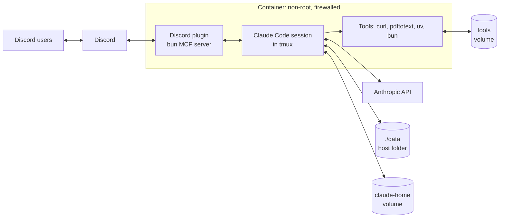

# Architecture

Sancho is one interactive Claude Code session, kept alive in a container, with the official Discord channel plugin feeding it messages.

## Message flow

1. A user @mentions Sancho, or replies to one of his messages, in an allowlisted channel.
2. The plugin checks the sender and channel against `access.json`. Anything not allowed is dropped before Claude sees it.
3. The message is injected into the running session as a channel event tagged with channel, message and user.
4. Claude works (web fetch, shell, files) and answers by calling the plugin's `reply` tool. Terminal output never reaches Discord.

The plugin exposes five tools: `reply`, `react`, `edit_message`, `fetch_messages`, `download_attachment`.

## Boot sequence

`restart: always` keeps the container up. Each start runs three scripts from `docker/`:

| Step | Script | Runs as | Does |
|---|---|---|---|
| 1 | `firewall.sh` | root | Rejects outbound traffic to private network ranges |
| 2 | `entrypoint.sh` | root, then `sancho` | Drops privileges, clears empty env vars, starts the rest |
| 3 | `setup.sh` | `sancho` | Pre-answers Claude Code's first-run prompts, seeds the Discord allowlist on first boot, installs the plugin and its dependencies |
| 4 | `entrypoint.sh` | `sancho` | Starts `claude --channels … --dangerously-skip-permissions` in tmux and waits on it |

Claude Code needs a terminal, which is why it runs inside tmux. If the session exits, the container exits and Docker restarts it.

## Storage

| Mount | Backing | Holds | Survives rebuild |
|---|---|---|---|
| `/data` | `./data` on the host | Persona, memory, articles, skills | Yes |
| `/home/sancho/.claude` | `claude-home` volume | Login, plugin, `access.json`, session history | Yes |
| `/opt/tools` | `tools` volume | Everything Sancho installs with `uv` | Yes |
| everything else | image | Claude Code, bun, uv, system packages | Rebuilt |

`./data` is the only host path in the container. The host's own `~/.claude` is never mounted.

## Instructions

Two files shape behaviour, loaded at session start:

- **`AGENTS.md`** is copied into the image as `/etc/claude-code/CLAUDE.md`, Claude Code's managed-policy location. It is root-owned, so the agent cannot rewrite its own safety rules. Changing it needs a rebuild.
- **`data/CLAUDE.md`** is the persona and working habits. Sancho may edit it. Changing it needs a restart.

## Memory

- **Within a run**: one conversation holds every message from every channel and user. Claude Code summarises older context as it grows.
- **Across restarts**: the conversation is not resumed. What carries over is whatever Sancho wrote to `data/memory/`, which he is told to do as he learns things.

## Access control

`access.json` in the `claude-home` volume is the plugin's allowlist, re-read on every inbound message.

- **Channels** are opt-in by ID. Each entry can require a mention and can restrict which users may trigger him.
- **DMs** follow `dmPolicy`: `pairing` (unknown users get a code that must be approved in the terminal), `allowlist`, or `disabled`.
- **First boot** writes an allowlist from `DISCORD_OWNER_ID` and `DISCORD_CHANNEL_ID` if set. After that the file is managed with `/discord:access` in the attached session.

## Isolation layers

| Layer | Mechanism |
|---|---|
| Filesystem | One host folder mounted; separate Claude config volume |
| Privileges | Non-root user, no `sudo`, `no-new-privileges`, all capabilities dropped except the three the root phase of the entrypoint needs |
| Network | `iptables` rejects 10/8, 172.16/12, 192.168/16, 169.254/16 and 100.64/10; public internet stays open |
| Resources | 2 GB memory, 512 processes |
| Behaviour | `AGENTS.md`: instructions come only from Discord messages; web content and files are data |

## Known limits

- **Prompt injection is mitigated, not solved.** The rules tell Sancho to ignore instructions in web pages and files, but a model can be fooled. The public internet is open, so a successful injection could leak the contents of `data/` or the API key and bot token held in the container's environment. Treat both as revocable and keep nothing private in `data/`.
- **No separation between users.** All channels share one conversation and one memory folder. Something said in one channel can surface in another.
- **The allowlist is protected by rule, not by permissions.** `access.json` is writable by the agent's user; only `AGENTS.md` tells him not to change it on request.
- **IPv6 filtering is best effort.** The IPv4 rules must apply or the container fails to start; the IPv6 rules are skipped if unavailable.
- **Root inside the container can lift the firewall.** The agent cannot become root, but `docker exec` as root from the host can.
- **One message at a time.** Messages queue while he is working, and messages sent while the container is down are missed.
- **Research preview.** Channels may change; the Claude Code version is pinned through the `CLAUDE_CODE_VERSION` build argument.
